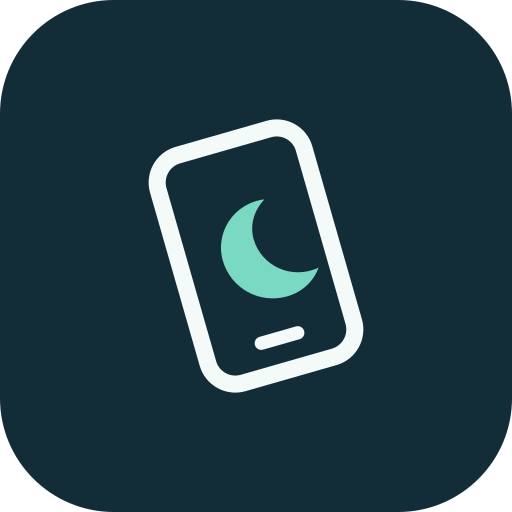

# Flip2DND Next

<p align="center">
  
  <br>
  <b>Flip your phone. Find your focus.</b>
</p>

**Flip2DND Next** is an independently developed evolution of
[Flip2DND by Abul Kalam Robin](https://github.com/robinsrk/Flip_2_DND).
It builds on the original open-source Android app with configurable detection,
feedback, scheduling, and improvements to background reliability and battery use.

Place your phone face down to activate Do Not Disturb. Flip it back up to restore
your previous state.

## Features

- Configurable flip sensitivity and activation delay from 0–10 seconds.
- Optional proximity gating to require a covered sensor before activation.
- DND, sound, and vibration schedule windows, including overnight windows.
- Filters for media playback, connected audio devices, and the flashlight.
- Custom audio files, vibration patterns, and adjustable vibration strength.
- Automatic startup after reboot and app updates, subject to Android settings.
- Material 3 interface, dynamic colors, dark mode, a widget, and a Quick Settings tile.
- No ads or tracking.

This continuation implements its own features and does not include the original
private Pro module. Paid upgrades and the upstream updater are absent from the
settings UI.

## Build and install

Build with Docker, Java 17, and Android SDK 36:

```sh
./scripts/build-apk.sh
```

The APK is generated at `app/build/outputs/apk/debug/app-debug.apk`.
The validated build is also available locally as `artifacts/Flip2DND-Next.apk`.
GitHub Actions builds a downloadable debug APK on pushes and pull requests.
See [Actions](https://github.com/EinMaulwurf/flip2dnd_next/actions) for build artifacts.
Build artifacts and signing keys are not committed.

Keep `.build-cache/` to retain the signing key for subsequent updates. The Android
package ID is `dev.flip2dnd.next`, including local debug builds. This installs as a
separate app alongside upstream and earlier Personal builds. Settings and permission
grants from those apps do not transfer automatically. Disable their detection
services before using Flip2DND Next.

See [build instructions and device checks](docker/README.md) for setup details and
[battery and reliability notes](docs/reliability-and-battery.md) for monitoring
strategies and limitations.

## Releases

Tag pushes (`v*`) run the release workflow, which tests the core module, builds a
release APK, signs it, and uploads it to GitHub Releases. Tags containing a hyphen
are marked as prereleases. Configure repository secrets `SIGNING_KEY` (base64 JKS),
`KEY_STORE_PASSWORD`, `KEY_ALIAS`, and `KEY_PASSWORD` before creating a release tag.
Keep a backup of that key: all future releases need it for in-place updates.

CI debug APKs use a temporary runner key and are intended for testing. They cannot
update an app installed with the release signing key.

## Project identity and attribution

The app name is **Flip2DND Next**, including the launcher, onboarding, notifications,
widget descriptions, Quick Settings tile, and store metadata. Android application
IDs, source namespaces, reflection paths, and ProGuard rules use `dev.flip2dnd.next`. Historical changelogs retain the original release names.

Source, issues, and releases for this continuation live at
[EinMaulwurf/flip2dnd_next](https://github.com/EinMaulwurf/flip2dnd_next).
Links to the original repository and purchase pages refer to upstream.
No separate app store listing has been published. The F-Droid metadata identifies
this continuation; catalog builds and automatic updates remain disabled until a
signed release is available.

This project is not presented as an official successor or an upstream release.
Thanks to Abul Kalam Robin and the original contributors for Flip2DND.

## License

[MIT](LICENSE). Original copyright and attribution are retained.
